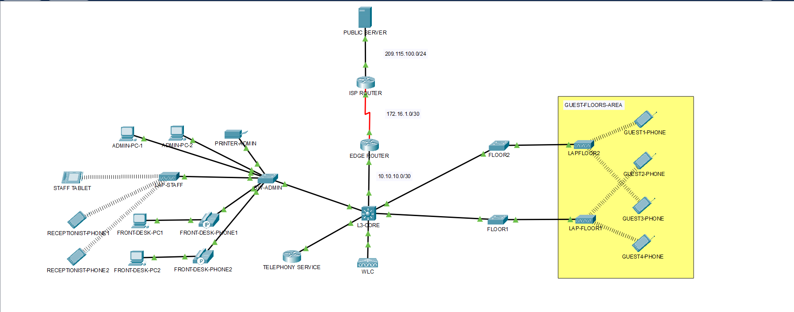

# Hotel Network Project Report

Nov 12, 2026

## Project Overview

This project is a hotel network built in Packet Tracer, with a Layer 3 core, wireless access for staff and guests, VoIP phones, and ACLs that control which VLANs can talk to each other.

The network has these main parts:

- An administration area with admin PCs, a printer, front desk PCs and IP phones, connected through SW-ADMIN
- Floor 1 and Floor 2 switches that connect the lightweight access points (LAPs) for guest Wi-Fi
- A wireless LAN controller (WLC) that manages all LAPs
- An L3 core switch that acts as DHCP server, performs inter-VLAN routing, and enforces ACLs
- A telephony service for the IP phones
- An edge router that performs NAT/PAT, and an ISP router that simulates the internet

## Network Topology

All traffic between VLANs passes through the L3 core, and all internet traffic leaves through the edge router.

- **Internet side:** Public server, ISP router (209.115.100.0/24 toward the server), then the edge router over 172.16.1.0/30
- **Core link:** The edge router connects to the L3 core over 10.10.10.0/30, a routed link
- **Administration area:** SW-ADMIN connects the admin PCs, printer, front desk PCs and phones, and LAP-STAFF
- **Guest floors:** The Floor 2 and Floor 3 switches connect LAPFLOOR2 and LAP-FLOOR1, which serve the guest Wi-Fi
- **Core services:** The WLC and the telephony service connect directly to the L3 core

## VLAN Table

| VLAN ID | Name | Subnet | Gateway (SVI) | Ports |
| --- | --- | --- | --- | --- |
| 10 | Admin | 192.168.10.0/24 | 192.168.10.1 | SW-ADMIN: F0/2-3 |
| 20 | Front Desk | 192.168.20.0/24 | 192.168.20.1 | SW-ADMIN: F0/4-5 |
| 30 | Printers | 192.168.30.0/24 | 192.168.30.1 | SW-ADMIN: F0/1 |
| 40 | Staff Wi-Fi | 192.168.40.0/24 | 192.168.40.1 | SW-ADMIN: G0/2 (trunked) |
| 50 | Guest Wi-Fi | 192.168.50.0/24 | 192.168.50.1 | FLOOR1 and FLOOR2: G0/2 (trunked) |
| 99 | Management | 192.168.99.0/24 | 192.168.99.1 | L3 SVI |
| 150 | Voice | 192.168.150.0/24 | 192.168.150.1 | SW-ADMIN: F0/4-5 |
| 999 | Unused Native | - | - | All unused ports in SW-ADMIN, L3-CORE, FLOOR1, and FLOOR2 |

## Addressing Table

| Device            | Interface | IP Address      | Subnet Mask     | Default Gateway         |
|-------------------|-----------|-----------------|-----------------|-------------------------|
| PUBLIC SERVER     | Fa0       | 209.115.100.100 | 255.255.255.0   | 209.115.100.1           |
| ISP ROUTER        | G0/0/0    | 209.115.100.1   | 255.255.255.0   | -                      |
| ISP ROUTER        | S0/1/0    | 172.16.1.1      | 255.255.255.252 | -                      |
| EDGE ROUTER       | S0/1/0    | 172.16.1.2      | 255.255.255.252 | Default route to S0/1/0 |
| EDGE ROUTER       | G0/0/0    | 10.10.10.1      | 255.255.255.252 | -                      |
| L3-CORE           | G1/0/1    | 10.10.10.2      | 255.255.255.252 | -                      |
| L3-CORE           | G1/0/24   | 120.100.90.2    | 255.255.255.192 | -                      |
| L3-CORE SVIs      | VLAN 10   | 192.168.10.1    | 255.255.255.0   | 192.168.10.1            |
|                   | VLAN 20   | 192.168.20.1    | 255.255.255.0   | 192.168.20.1            |
|                   | VLAN 30   | 192.168.30.1    | 255.255.255.0   | 192.168.30.1            |
|                   | VLAN 40   | 192.168.40.1    | 255.255.255.0   | 192.168.40.1            |
|                   | VLAN 50   | 192.168.50.1    | 255.255.255.0   | 192.168.50.1            |
|                   | VLAN 99   | 192.168.99.1    | 255.255.255.0   | 192.168.99.1            |
|                   | VLAN 150  | 192.168.150.1   | 255.255.255.0   | 192.168.150.1           |
|                   | VLAN 999  | -              | -              | -                      |
| WLC (management)  | VLAN99    | 192.168.99.2    | 255.255.255.0   | 192.168.99.1            |
| TELEPHONY SERVICE | Fa0/0     | 120.100.90.1    | 255.255.255.192 | 120.100.90.2            |
| SW-ADMIN          | VLAN 99   | 192.168.99.6    | 255.255.255.0   | 192.168.99.1            |
| ADMIN-PC-1        | Fa0       | DHCP            | DHCP            | 192.168.10.1            |
| ADMIN-PC-2        | Fa0       | DHCP            | DHCP            | 192.168.10.1            |
| PRINTER-ADMIN     | Fa0       | DHCP            | DHCP            | 192.168.30.1            |
| FRONT-DESK-PC1    | Fa0       | DHCP            | DHCP            | 192.168.20.1            |
| FRONT-DESK-PC2    | Fa0       | DHCP            | DHCP            | 192.168.20.1            |

## Device Configuration

Each device was configured for one role: access switching, wireless control, routing and DHCP, telephony, or internet connectivity.

**SW-ADMIN**

- VLANs created and assigned
- Trunk links configured
- SSH enabled for remote management
- Access ports configured for end devices

**Floor 2 and Floor 3 switches**

- Trunk lines configured toward the LAPs

**Wireless LAN controller (WLC)**

- Configured from the admin PC
- Two interfaces added: Staff and Guest
- Two WLANs created: STAFF and GUEST
- APs separated into AP groups, with Staff APs in their own group and Guest APs in another

**Layer 3 core switch (L3-CORE)**

- DHCP server for all VLANs
- Default route toward the edge router
- OSPF routing enabled
- ACLs applied per VLAN (see Access Control Policy)
- DHCP option 150 in the VLAN 150 (voice) pool, pointing the phones to the telephony service at 120.100.90.1

**Telephony service**

- Telephony service configured for the IP phones

**Edge router**

- NAT/PAT configured on the interface facing the ISP router
- OSPF enabled, with the default route originated into OSPF
- Default route out of s0/1/0 toward the ISP router

**ISP router**

- Acts as a simulation of the internet

## Access Control Policy

ACLs on the L3 core control which VLANs can talk to each other: the Admin VLAN can reach everything, while Staff and Guest users are limited to DHCP and web access.

| VLAN           | Allowed                                                                        | Blocked                                                 |
|----------------|--------------------------------------------------------------------------------|---------------------------------------------------------|
| 10 Admin       | Access to all VLANs                                                            | Other hosts cannot ping Admin; only echo replies return |
| 20 Front Desk  | Web and DHCP; admin echo replies                                               | Everything else                                         |
| 30 Printers    | Admin echo replies; traffic to Admin, since the printer sits in the admin area | Everything else                                         |
| 40 Staff Wi-Fi | Web and DHCP; ping to its own gateway                                          | Ping to Admin, Front Desk, Printers, and Guests         |
| 50 Guest Wi-Fi | DHCP and web                                                                   | Ping to other networks                                  |
| 99 Management  | Admin only                                                                     | All other sources                                       |

**Verification:** Staff and Guest devices were tested with SSH toward important devices, and the connections were blocked, which confirms the ACLs are filtering as intended.

## Troubleshooting Log

Two problems took real effort: a missing return rule in an ACL, and an OSPF process that would not build routes.

### Issue 1: Admin PC could not connect to the WLC

**Steps checked, in order:**

1.  The admin PC's IP configuration
2.  The interface status
3.  Ping from the admin PC to the WLC, which failed
4.  The SVIs on the L3 core
5.  Ping from the L3 core to the WLC
6.  The ACLs

**Fix:** Added an ACL line that permits the WLC to reach the Admin VLAN.

**Lesson learned:** ACLs are stateless, meaning they keep no memory of traffic that already passed. The ACL on VLAN 99 permitted inbound traffic from VLAN 10, so the admin PC could reach the WLC, but no line allowed the WLC to answer back to VLAN 10. Adding the return line let both sides communicate.

### Issue 2: Staff phones on Wi-Fi could not ping the DNS server

**Steps checked, in order:**

1.  The phone's IP configuration
2.  The LAP configuration through the WLC
3.  Ping to the default gateway
4.  The SVIs
5.  Traceroute to the DNS server
6.  The routing on the L3 core
7.  The routing on the edge router

**Fix:** Two changes were needed.

- Added an ACL line that lets the Staff Wi-Fi VLAN ping its own gateway.
- Restarted the edge router. It was stuck and could not build the OSPF routes, even though the configuration was correct on both the router and the L3 core. Both devices already showed a FULL adjacency, with one acting as the BDR, and it took almost 30 minutes to find that the configuration was not at fault. This appears to be a Packet Tracer bug.

**Lesson learned:** ACLs also filter traffic aimed at the gateway itself, so each VLAN needs a rule for it. And when OSPF shows a FULL neighbor state but routes are missing despite a matching configuration, the simulator may be the cause, and a restart can clear it.

## New Concepts Introduced

This project introduced five concepts that were new compared with earlier practice labs:

- **ACLs in a project environment:** filtering traffic between VLANs by source, destination, and protocol
- **Telephony services and VoIP phones:** call setup for IP phones, with DHCP option 150 pointing them to the telephony service
- **WLC-based AP management:** controlling all APs from one controller instead of configuring them one by one
- **OSPF and default routing:** dynamic routing between the L3 core and the edge router, plus a default route to the ISP
- **NAT/PAT:** letting private internal addresses reach the internet through the edge router's outside interface

## Conclusion

The hotel network works end to end: all VLANs can reach the DNS server, internet traffic leaves with the edge router's address, which confirms PAT is working, and the ACLs keep Staff and Guest users away from Admin and Management resources. The two troubleshooting cases showed that ACLs need return rules and that a correct configuration can still fail in the simulator, so checking each layer in order is the reliable approach.
